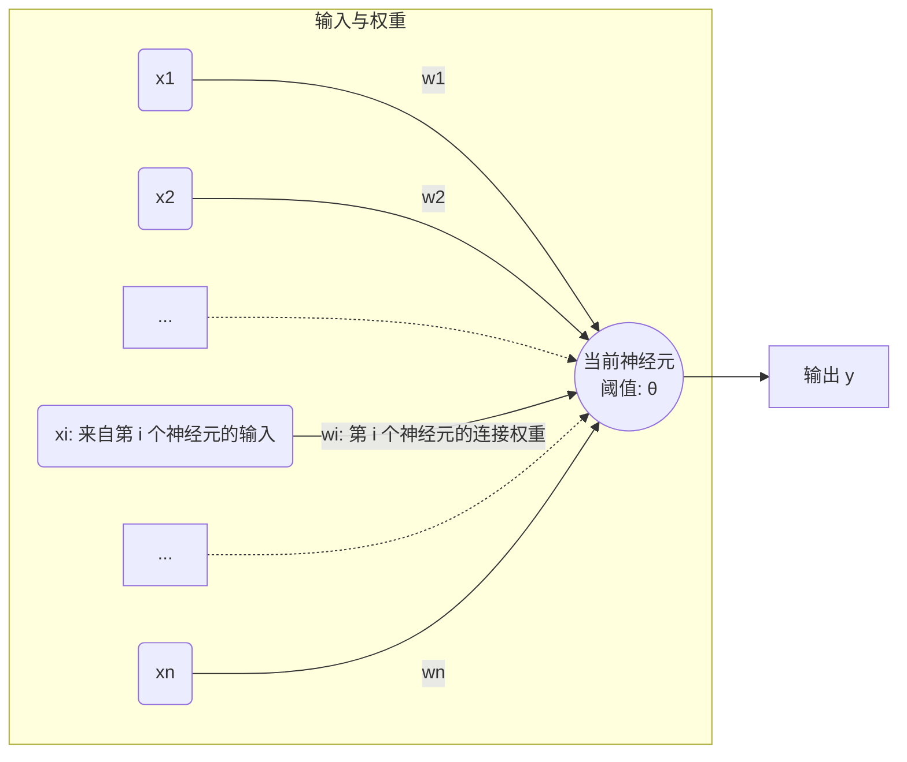
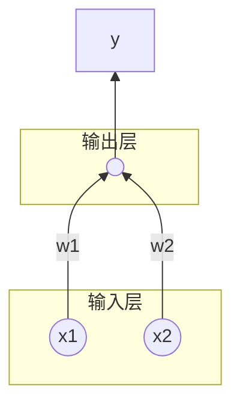

# 神经网络
## 神经元模型
M-P神经元模型

神经元接收其他 $n$ 个神经元传递的输入信号，将输入信号通过带权重连接进行传递

神经元接收到的总输入值和阈值进行比较
$$y = f\left(\sum_{i=1}^{n} w_i x_i - \theta\right)$$
最后经过激活函数处理产生神经元的输出

常使用`Sigmoid`函数作为激活函数
$$\sigma(x) = \frac{1}{1 + e^{-x}}$$
其中`Sigmoid`函数的导数形式非常优美
$$\sigma'(x) = \sigma(x)\big(1 - \sigma(x)\big)$$

## 感知机和多层网络
### 感知机：适合解决线性可分问题
感知机由两层神经元组成，输出层是M-P神经元（阈值逻辑单元）

给定训练集 $\boldsymbol{X}$ ，权重 $w_i(i=1,2,3....n)$ 和阈值 $\theta$ 可以通过学习得到

我们可以将 $\theta$ 视为输入固定为 $-1$ 的哑节点的权重，将阈值统一到连接权重中

对当前样本 $(\boldsymbol{X},y)$，感知机权重调整
$$w_i \leftarrow w_i + \Delta w_i \$$
$$\Delta w_i = \eta (y - \hat{y}) x_i \$$

1. 见好就收训练机制：只要预测值和真实标签相等，算法就会立刻停止
2. 解不唯一：线性可分问题有无数条解直线，只要能分开就是合格解，找到最优解是SVM的内容
### 多层神经网络：适合解决非线性可分问题
多层前馈神经网络
* 每层神经元与下一层全互连
* 神经元不存在同层连接和跨层连接
* 输入层只接受输入，隐层和输出层包含神经元功能

## 反向传播BackPropagation算法：迄今最成功的神经网络学习算法
**误差逆传播（BackPropagation，简称 BP）算法**是整个深度学习的基石

### 一、 网络结构与核心符号梳理（看懂图 5.7）

在看推导之前，必须先把西瓜书图 5.7 的符号认死，尤其是**阈值（偏置）的减号约定**

假设我们有一个单隐层前馈神经网络（图 5.7）：
*   **输入层**：$d$ 个神经元，接收样本 $\boldsymbol{x}_k = (x_1, x_2, \dots, x_d)$
*   **隐层**：$q$ 个神经元
    *   输入层第 $i$ 个神经元到隐层第 $h$ 个神经元的连接权为：$v_{ih}$
    *   隐层第 $h$ 个神经元接收到的总输入：$\alpha_h = \sum_{i=1}^d v_{ih} x_i$
    *   隐层第 $h$ 个神经元的**阈值**为：$\gamma_h$
    *   隐层第 $h$ 个神经元的输出为：$b_h = f(\alpha_h - \gamma_h)$
*   **输出层**：$l$ 个神经元，对应真实标记 $\boldsymbol{y}_k = (y_1^k, y_2^k, \dots, y_l^k)$
    *   隐层第 $h$ 个神经元到输出层第 $j$ 个神经元的连接权为：$w_{hj}$
    *   输出层第 $j$ 个神经元接收到的总输入：$\beta_j = \sum_{h=1}^q w_{hj} b_h$
    *   输出层第 $j$ 个神经元的**阈值**为：$\theta_j$
    *   输出层第 $j$ 个神经元的输出为：$\hat{y}_j^k = f(\beta_j - \theta_j)$ 【式 (5.3)】

> **【关键细节提醒】**
> 1. **激活函数统一**：西瓜书中隐层和输出层均采用 Sigmoid 函数 $f(x) = \frac{1}{1 + e^{-x}}$
> 2. **“减阈值”约定**：现代深度学习框架通常写作 $w x + b$（加偏置），但西瓜书遵循早期文献习惯，写作 $\text{输入} - \text{阈值}$（即 $\beta_j - \theta_j$ 和 $\alpha_h - \gamma_h$）**这导致阈值更新公式 (5.12) 和 (5.14) 前面带有一个负号**，推导时务必留意
> 3. **参数总数**：共有 $d \times q$ 个 $v_{ih}$，$q \times l$ 个 $w_{hj}$，$q$ 个 $\gamma_h$，$l$ 个 $\theta_j$，合计 $(d+l+1)q + l$ 个待定参数

---

### 二、 零跳步严密数学推导

#### 前置引理：证明 Sigmoid 函数的导数性质【式 (5.9)】
设 $f(x) = \frac{1}{1 + e^{-x}} = (1 + e^{-x})^{-1}$，对其求导：
$$f'(x) = -(1 + e^{-x})^{-2} \cdot (-e^{-x}) = \frac{e^{-x}}{(1 + e^{-x})^2}$$
将其拆分为两项乘积：
$$f'(x) = \frac{1}{1 + e^{-x}} \cdot \frac{e^{-x}}{1 + e^{-x}} = \frac{1}{1 + e^{-x}} \cdot \frac{(1 + e^{-x}) - 1}{1 + e^{-x}} = \frac{1}{1 + e^{-x}} \left(1 - \frac{1}{1 + e^{-x}}\right)$$
即得到极优美的性质【式 (5.9)】：
$$f'(x) = f(x)\bigl(1 - f(x)\bigr)$$

---

#### 目标函数与梯度下降策略
对于单个训练样本 $(\boldsymbol{x}_k, \boldsymbol{y}_k)$，网络输出为 $\hat{\boldsymbol{y}}_k = (\hat{y}_1^k, \dots, \hat{y}_l^k)$，均方误差定义为【式 (5.4)】：
$$E_k = \frac{1}{2} \sum_{j=1}^l (\hat{y}_j^k - y_j^k)^2$$
*（注：系数 $\frac{1}{2}$ 是为了求导时和平方项的指数 $2$ 抵消）*

BP 算法采用**梯度下降**，任何参数 $v$ 的更新规则为 $v \leftarrow v + \Delta v$【式 (5.5)】，其中步长更新量为负梯度乘以学习率 $\eta$：
$$\Delta v = -\eta \frac{\partial E_k}{\partial v}$$

我们需要推导 **4 类参数**（$w_{hj}, \theta_j, v_{ih}, \gamma_h$）的更新公式。西瓜书省略了 $\theta_j, v_{ih}, \gamma_h$ 的详细推导（只写了“类似可得”），下面我们把这 4 个公式全部一字不漏地推出来。

---

#### 1. 推导隐层到输出层权值 $w_{hj}$ 的更新公式【式 (5.10)、(5.11)】

**影响路径**：观察前向计算式可知，$w_{hj}$ 仅出现在第 $j$ 个输出神经元的输入 $\beta_j = \sum_{h=1}^q w_{hj} b_h$ 中，它**只影响** $\beta_j$，进而**只影响** $\hat{y}_j^k$，最终影响 $E_k$（与其他输出神经元 $j' \neq j$ 无关）

根据复合函数求导的**链式法则**【式 (5.7)】：
$$\frac{\partial E_k}{\partial w_{hj}} = \frac{\partial E_k}{\partial \hat{y}_j^k} \cdot \frac{\partial \hat{y}_j^k}{\partial \beta_j} \cdot \frac{\partial \beta_j}{\partial w_{hj}}$$

我们逐项计算这三个偏导数：

*   **第一项 $\frac{\partial E_k}{\partial \hat{y}_j^k}$**：
    将 $E_k = \frac{1}{2} \sum_{r=1}^l (\hat{y}_r^k - y_r^k)^2$ 对 $\hat{y}_j^k$ 求偏导。求和中只有 $r = j$ 这一项含有 $\hat{y}_j^k$，其余项对 $\hat{y}_j^k$ 的导数全为 $0$：
    $$\frac{\partial E_k}{\partial \hat{y}_j^k} = \frac{1}{2} \cdot 2(\hat{y}_j^k - y_j^k) \cdot 1 = \hat{y}_j^k - y_j^k$$

*   **第二项 $\frac{\partial \hat{y}_j^k}{\partial \beta_j}$**：
    由 $\hat{y}_j^k = f(\beta_j - \theta_j)$，令中间变量 $u = \beta_j - \theta_j$，则 $\frac{\partial u}{\partial \beta_j} = 1$。利用链式法则与式 (5.9)：
    $$\frac{\partial \hat{y}_j^k}{\partial \beta_j} = f'(\beta_j - \theta_j) \cdot \frac{\partial(\beta_j - \theta_j)}{\partial \beta_j} = f'(\beta_j - \theta_j) \cdot 1 = f(\beta_j - \theta_j)\bigl(1 - f(\beta_j - \theta_j)\bigr) = \hat{y}_j^k(1 - \hat{y}_j^k)$$

*   **第三项 $\frac{\partial \beta_j}{\partial w_{hj}}$**：
    由 $\beta_j = \sum_{r=1}^q w_{rj} b_r$，求和中只有 $r=h$ 这一项含有 $w_{hj}$，其余项对 $w_{hj}$ 求导为 $0$，因此【式 (5.8)】：
    $$\frac{\partial \beta_j}{\partial w_{hj}} = b_h$$

将前三项乘在一起，并结合负梯度定义 $\Delta w_{hj} = -\eta \frac{\partial E_k}{\partial w_{hj}}$【式 (5.6)】：
$$\Delta w_{hj} = -\eta \left(\frac{\partial E_k}{\partial \hat{y}_j^k} \cdot \frac{\partial \hat{y}_j^k}{\partial \beta_j}\right) \cdot \frac{\partial \beta_j}{\partial w_{hj}}$$

西瓜书为了书写简洁，将括号内带负号的部分定义为**输出层第 $j$ 个神经元的梯度项 $g_j$**【式 (5.10)】：
$$g_j \triangleq -\frac{\partial E_k}{\partial \hat{y}_j^k} \cdot \frac{\partial \hat{y}_j^k}{\partial \beta_j} = -(\hat{y}_j^k - y_j^k) f'(\beta_j - \theta_j) = \hat{y}_j^k (1 - \hat{y}_j^k)(y_j^k - \hat{y}_j^k)$$
*（注意这里负号把 $\hat{y}_j^k - y_j^k$ 翻转成了 $y_j^k - \hat{y}_j^k$，即“真实值减预测值”）*

将 $g_j$ 和式 (5.8) 代回 $\Delta w_{hj}$，立刻得到 $w_{hj}$ 的更新公式【式 (5.11)】：
$$\Delta w_{hj} = \eta g_j b_h$$

---

#### 2. 推导输出层阈值 $\theta_j$ 的更新公式【式 (5.12)】（书上省略，这里补全）

**影响路径**：$\theta_j$ 只影响 $\hat{y}_j^k = f(\beta_j - \theta_j)$，进而影响 $E_k$

由梯度下降与链式法则：
$$\Delta \theta_j = -\eta \frac{\partial E_k}{\partial \theta_j} = -\eta \left( \frac{\partial E_k}{\partial \hat{y}_j^k} \cdot \frac{\partial \hat{y}_j^k}{\partial \theta_j} \right)$$

计算 $\frac{\partial \hat{y}_j^k}{\partial \theta_j}$：
令 $u = \beta_j - \theta_j$，注意这里对 $\theta_j$ 求偏导会出现一个 **$-1$**：
$$\frac{\partial \hat{y}_j^k}{\partial \theta_j} = f'(\beta_j - \theta_j) \cdot \frac{\partial (\beta_j - \theta_j)}{\partial \theta_j} = f'(\beta_j - \theta_j) \cdot (-1) = -\frac{\partial \hat{y}_j^k}{\partial \beta_j}$$

代回 $\Delta \theta_j$：
$$\Delta \theta_j = -\eta \cdot \frac{\partial E_k}{\partial \hat{y}_j^k} \cdot \left(-\frac{\partial \hat{y}_j^k}{\partial \beta_j}\right) = -\eta \left(-\frac{\partial E_k}{\partial \hat{y}_j^k} \cdot \frac{\partial \hat{y}_j^k}{\partial \beta_j}\right) \cdot (-1) \quad \text{？}$$
*慢着，别被负号绕晕，直接看最上面那行乘积：*
两个负号（梯度下降的负号、$\frac{\partial(\beta_j-\theta_j)}{\partial\theta_j}=-1$）相乘为正：
$$\Delta \theta_j = +\eta \left(\frac{\partial E_k}{\partial \hat{y}_j^k} \cdot f'(\beta_j - \theta_j)\right) = -\eta \left(-\frac{\partial E_k}{\partial \hat{y}_j^k} \cdot \frac{\partial \hat{y}_j^k}{\partial \beta_j}\right)$$
而括号里的部分正好就是刚才定义的 $g_j$！于是得到【式 (5.12)】：
$$\Delta \theta_j = -\eta g_j$$

---

#### 3. 推导输入层到隐层权值 $v_{ih}$ 的更新公式【式 (5.13)、(5.15)】（核心难点）

**影响路径**：为什么隐层的推导最关键？
因为 $v_{ih}$ 影响隐层第 $h$ 个神经元的输入 $\alpha_h$，进而影响隐层输出 $b_h$；而 **$b_h$ 连接着输出层的所有 $l$ 个神经元**（$\beta_1, \beta_2, \dots, \beta_l$ 都包含 $w_{hj} b_h$）！所以 $b_h$ 会通过所有输出神经元共同影响最终的 $E_k$

根据多元复合函数的链式法则：
$$\frac{\partial E_k}{\partial v_{ih}} = \frac{\partial E_k}{\partial b_h} \cdot \frac{\partial b_h}{\partial \alpha_h} \cdot \frac{\partial \alpha_h}{\partial v_{ih}}$$

同样逐项严密展开：

*   **第一项 $\frac{\partial E_k}{\partial b_h}$**（误差反向传播的核心一步！）：
    由于 $b_h$ 同时流向 $\beta_1, \beta_2, \dots, \beta_l$ 这 $l$ 个输出神经元的输入，由多元链式法则必须**对 $j=1 \dots l$ 求和**：
    $$\frac{\partial E_k}{\partial b_h} = \sum_{j=1}^l \frac{\partial E_k}{\partial \beta_j} \cdot \frac{\partial \beta_j}{\partial b_h}$$
    *   其中 $\frac{\partial E_k}{\partial \beta_j} = \frac{\partial E_k}{\partial \hat{y}_j^k} \cdot \frac{\partial \hat{y}_j^k}{\partial \beta_j}$，对照式 (5.10) 的定义，这正好就是 **$-g_j$**！
    *   其中 $\beta_j = \sum_{r=1}^q w_{rj} b_r$，对 $b_h$ 求偏导，只有 $r=h$ 项留存，得到 $\frac{\partial \beta_j}{\partial b_h} = w_{hj}$
    
    所以：
    $$\frac{\partial E_k}{\partial b_h} = \sum_{j=1}^l (-g_j) \cdot w_{hj} = -\sum_{j=1}^l w_{hj} g_j$$

*   **第二项 $\frac{\partial b_h}{\partial \alpha_h}$**：
    由 $b_h = f(\alpha_h - \gamma_h)$ 及式 (5.9)：
    $$\frac{\partial b_h}{\partial \alpha_h} = f'(\alpha_h - \gamma_h) \cdot \frac{\partial(\alpha_h - \gamma_h)}{\partial \alpha_h} = b_h(1 - b_h) \cdot 1 = b_h(1 - b_h)$$

*   **第三项 $\frac{\partial \alpha_h}{\partial v_{ih}}$**：
    由 $\alpha_h = \sum_{r=1}^d v_{rh} x_r$，求和中只有 $r=i$ 项含有 $v_{ih}$，因此：
    $$\frac{\partial \alpha_h}{\partial v_{ih}} = x_i$$

现在把三项代入梯度下降公式 $\Delta v_{ih} = -\eta \frac{\partial E_k}{\partial v_{ih}}$：
$$\Delta v_{ih} = -\eta \left( \frac{\partial E_k}{\partial b_h} \cdot \frac{\partial b_h}{\partial \alpha_h} \right) \cdot \frac{\partial \alpha_h}{\partial v_{ih}}$$

模仿 $g_j$ 的定义，我们把括号里带负号的部分定义为**隐层第 $h$ 个神经元的梯度项 $e_h$**【式 (5.15)】：
$$e_h \triangleq -\frac{\partial E_k}{\partial b_h} \cdot \frac{\partial b_h}{\partial \alpha_h} = -\left(-\sum_{j=1}^l w_{hj} g_j\right) \cdot f'(\alpha_h - \gamma_h) = b_h(1 - b_h) \sum_{j=1}^l w_{hj} g_j$$
*（看！隐层的误差梯度 $e_h$ 是由输出层所有神经元的梯度 $g_j$ 沿着连接权 $w_{hj}$ 加权“逆向传回”并乘上本层导数 $b_h(1-b_h)$ 得到的，这就是**“误差逆传播”**名字的由来！）*

将 $e_h$ 与 $\frac{\partial \alpha_h}{\partial v_{ih}} = x_i$ 代回 $\Delta v_{ih}$，即得【式 (5.13)】：
$$\Delta v_{ih} = \eta e_h x_i$$

---

#### 4. 推导隐层阈值 $\gamma_h$ 的更新公式【式 (5.14)】（书上省略，这里补全）

**影响路径**：$\gamma_h$ 只影响 $b_h = f(\alpha_h - \gamma_h)$，进而影响 $E_k$

$$\Delta \gamma_h = -\eta \frac{\partial E_k}{\partial \gamma_h} = -\eta \left(\frac{\partial E_k}{\partial b_h} \cdot \frac{\partial b_h}{\partial \gamma_h}\right)$$

计算 $\frac{\partial b_h}{\partial \gamma_h}$：
$$\frac{\partial b_h}{\partial \gamma_h} = f'(\alpha_h - \gamma_h) \cdot \frac{\partial(\alpha_h - \gamma_h)}{\partial \gamma_h} = b_h(1 - b_h) \cdot (-1) = -\frac{\partial b_h}{\partial \alpha_h}$$

代回 $\Delta \gamma_h$：
$$\Delta \gamma_h = -\eta \left(\frac{\partial E_k}{\partial b_h} \cdot \left(-\frac{\partial b_h}{\partial \alpha_h}\right)\right) = -\eta \left(-\frac{\partial E_k}{\partial b_h} \cdot \frac{\partial b_h}{\partial \alpha_h}\right) = -\eta e_h$$
即得到【式 (5.14)】：
$$\Delta \gamma_h = -\eta e_h$$

---

### 三、 完整手算实例（2-2-2 网络跑通一轮 BP）

为了让你看到每个公式在真实数字下是如何运作的，我们构造一个与西瓜书图 5.9 相同结构的 **2 输入、2 隐层、2 输出**网络，完整手算一轮前向传播与逆向更新。

*   **样本**：$\boldsymbol{x} = (x_1, x_2) = (1, 0)$，真实标签 $\boldsymbol{y} = (y_1, y_2) = (1, 0)$
*   **学习率**：$\eta = 0.1$（西瓜书推荐常用默认值）
*   **初始参数**：
    *   输入层 $\to$ 隐层：$v_{11}=0.2,\ v_{21}=0.4,\ \gamma_1=0.1$；$\quad v_{12}=-0.3,\ v_{22}=0.1,\ \gamma_2=0.2$
    *   隐层 $\to$ 输出层：$w_{11}=0.5,\ w_{21}=-0.2,\ \theta_1=0.1$；$\quad w_{12}=-0.4,\ w_{22}=0.6,\ \theta_2=-0.1$

#### 第 1 步：前向传播（对应图 5.8 第 4 行）

1. **计算隐层输入与输出**：
   * 隐层神经元 1：
     $$\alpha_1 = v_{11}x_1 + v_{21}x_2 = 0.2 \times 1 + 0.4 \times 0 = 0.2$$
     $$b_1 = f(\alpha_1 - \gamma_1) = \frac{1}{1 + e^{-(0.2 - 0.1)}} = \frac{1}{1 + e^{-0.1}} \approx 0.5250$$
   * 隐层神经元 2：
     $$\alpha_2 = v_{12}x_1 + v_{22}x_2 = -0.3 \times 1 + 0.1 \times 0 = -0.3$$
     $$b_2 = f(\alpha_2 - \gamma_2) = \frac{1}{1 + e^{-(-0.3 - 0.2)}} = \frac{1}{1 + e^{0.5}} \approx 0.3775$$

2. **计算输出层输入与预测输出**：
   * 输出神经元 1：
     $$\beta_1 = w_{11}b_1 + w_{21}b_2 = 0.5 \times 0.5250 + (-0.2) \times 0.3775 = 0.1870$$
     $$\hat{y}_1 = f(\beta_1 - \theta_1) = \frac{1}{1 + e^{-(0.1870 - 0.1)}} = \frac{1}{1 + e^{-0.0870}} \approx 0.5217$$
   * 输出神经元 2：
     $$\beta_2 = w_{12}b_1 + w_{22}b_2 = (-0.4) \times 0.5250 + 0.6 \times 0.3775 = 0.0165$$
     $$\hat{y}_2 = f(\beta_2 - \theta_2) = \frac{1}{1 + e^{-(0.0165 - (-0.1))}} = \frac{1}{1 + e^{-0.1165}} \approx 0.5291$$

3. **当前误差**（仅用于观察）：
   $$E_k = \frac{1}{2}\left[(0.5217 - 1)^2 + (0.5291 - 0)^2\right] \approx 0.2544$$
   *(可见：$\hat{y}_1 = 0.5217$ 比目标 $1$ 小，需要变大；$\hat{y}_2 = 0.5291$ 比目标 $0$ 大，需要变小)*

#### 第 2 步：计算输出层梯度项 $g_j$（对应图 5.8 第 5 行，式 5.10）

$$g_1 = \hat{y}_1(1-\hat{y}_1)(y_1 - \hat{y}_1) = 0.5217 \times (1 - 0.5217) \times (1 - 0.5217) \approx 0.1194$$
$$g_2 = \hat{y}_2(1-\hat{y}_2)(y_2 - \hat{y}_2) = 0.5291 \times (1 - 0.5291) \times (0 - 0.5291) \approx -0.1318$$

#### 第 3 步：误差逆传播，计算隐层梯度项 $e_h$（对应图 5.8 第 6 行，式 5.15）

*   隐层神经元 1（将 $g_1, g_2$ 加权传回）：
    $$e_1 = b_1(1 - b_1)(w_{11}g_1 + w_{12}g_2) = 0.5250 \times 0.4750 \times \bigl[0.5 \times 0.1194 + (-0.4) \times (-0.1318)\bigr]$$
    $$= 0.2494 \times (0.0597 + 0.0527) \approx 0.0280$$
*   隐层神经元 2：
    $$e_2 = b_2(1 - b_2)(w_{21}g_1 + w_{22}g_2) = 0.3775 \times 0.6225 \times \bigl[(-0.2) \times 0.1194 + 0.6 \times (-0.1318)\bigr]$$
    $$= 0.2350 \times (-0.0239 - 0.0791) \approx -0.0242$$

#### 第 4 步：更新所有连接权与阈值（对应图 5.8 第 7 行，式 5.11–5.14）

*   **更新隐层 $\to$ 输出层权值 $w_{hj} \leftarrow w_{hj} + \eta g_j b_h$**：
    *   $w_{11} \leftarrow 0.5 + 0.1 \times 0.1194 \times 0.5250 = 0.5063$ （增大，助推 $\hat{y}_1$ 变大）
    *   $w_{12} \leftarrow -0.4 + 0.1 \times (-0.1318) \times 0.5250 = -0.4069$ （减小，助推 $\hat{y}_2$ 变小）
    *   $w_{21} \leftarrow -0.2 + 0.1 \times 0.1194 \times 0.3775 = -0.1955$ （增大）
    *   $w_{22} \leftarrow 0.6 + 0.1 \times (-0.1318) \times 0.3775 = 0.5950$ （减小）
*   **更新输出层阈值 $\theta_j \leftarrow \theta_j - \eta g_j$**：
    *   $\theta_1 \leftarrow 0.1 - 0.1 \times 0.1194 = 0.0881$ （阈值减小，相当于 $\beta_1-\theta_1$ 变大，$\hat{y}_1$ 变大）
    *   $\theta_2 \leftarrow -0.1 - 0.1 \times (-0.1318) = -0.0868$ （阈值增大，相当于 $\beta_2-\theta_2$ 变小，$\hat{y}_2$ 变小）
*   **更新输入层 $\to$ 隐层权值 $v_{ih} \leftarrow v_{ih} + \eta e_h x_i$**：
    *   $v_{11} \leftarrow 0.2 + 0.1 \times 0.0280 \times 1 = 0.2028$
    *   $v_{21} \leftarrow 0.4 + 0.1 \times 0.0280 \times 0 = 0.4000$ （注意！因为 $x_2=0$，未激活，其权重不更新）
    *   $v_{12} \leftarrow -0.3 + 0.1 \times (-0.0242) \times 1 = -0.3024$
    *   $v_{22} \leftarrow 0.1 + 0.1 \times (-0.0242) \times 0 = 0.1000$
*   **更新隐层阈值 $\gamma_h \leftarrow \gamma_h - \eta e_h$**：
    *   $\gamma_1 \leftarrow 0.1 - 0.1 \times 0.0280 = 0.0972$
    *   $\gamma_2 \leftarrow 0.2 - 0.1 \times (-0.0242) = 0.2024$

你会发现，所有参数的调整方向与“让 $\hat{y}_1 \to 1$、$\hat{y}_2 \to 0$”的物理直觉**完全一致**！

---

### 四、 西瓜书 5.3 节其余核心知识点串联

看懂推导后，书中第 104–106 页的几个工程与理论要点也非常关键：

1. **标准 BP vs 累积 BP（第 104–105 页）**
   * **标准 BP 算法**：就是图 5.8 展示的算法。每读入**一个**样本 $(\boldsymbol{x}_k, \boldsymbol{y}_k)$，就基于单个样本误差 $E_k$ 更新一次参数（对应现代的随机梯度下降 **SGD**）。缺点是不同样本的更新方向可能互相“抵消”，需要更多轮（epoch）才能收敛；优点是在大数据集上往往能更快找到较好的解。
   * **累积 BP 算法**：基于全数据集的累积误差 $E = \frac{1}{m}\sum_{k=1}^m E_k$ 【式 (5.16)】进行推导，读完**整个训练集**一遍后才统一更新一次参数（对应标准梯度下降 **Batch GD**）。参数更新频率低，但累积误差下降到一定程度后会非常缓慢
   *(注：现代深度学习折中采用了 Mini-batch SGD，即小批量梯度下降)*

2. **隐层结构与万能逼近定理（第 105 页）**
   * Hornik 等人在 1989 年证明：**只需一个包含足够多隐层神经元的单隐层前馈网络，就能以任意精度逼近任意复杂度的连续函数**
   * 但隐层到底设多少个神经元没有解析公式，实际中靠**“试错法”（trial-by-error）**调整

3. **缓解 BP 网络过拟合的两大策略（第 105–106 页）**
   因为神经网络表示能力极强，极易过拟合（训练误差一直降，测试误差先降后升）西瓜书给出了两种经典对策：
   * **早停**：划分训练集和验证集。用训练集更新权重，每次在验证集上测误差。一旦发现“训练误差还在降，但验证集误差开始上升”，立刻停止训练，并回滚返回验证集误差最小的那一组参数
   * **正则化**【式 (5.17)】：在损失函数中加入惩罚项（所有连接权与阈值的平方和，即 L2 正则化/权重衰减）：
     $$E = \lambda \frac{1}{m}\sum_{k=1}^m E_k + (1-\lambda)\sum_i w_i^2$$
     其中 $\lambda \in (0, 1)$ 通过交叉验证确定。加入 $\sum w_i^2$ 后，优化过程会偏好**数值较小**的连接权和阈值（对应模型复杂度低），从而使网络输出曲线更加“光滑”，有效缓解过拟合

## 全局最小与局部最小
### 关于最小值和极小值点
训练神经网络本质上是在 $(w,b)$ 构成的参数空间中寻找能使误差 $E$ 最小的一组误差

核心痛点：**全局最小”一定是“局部极小”，但“局部极小”不一定是“全局最小”**
### 为什么会陷入局部极小值
BP算法本质是梯度下降：每次向着负梯度方向移动

只要计算出梯度为0算法自动停止，这时候有可能在局部极小而非全局最小值
### 如何跳出局部极小值
1. 多次空降：随机多组不同的初始权重训练多个神经网络，最后挑选误差最小的神经网络
2. 模拟退火：训练过程中以一定概率接受比当前更差的结果（允许偶然往高处走）并且这个概率随着训练进行逐渐降低
3. 随机梯度下降：相较于标准梯度下降使用全部训练集计算梯度，随机梯度下降使用单个样本（相当于增加噪声）

## 其他常见的神经网络
### RBF网络：径向基函数网络
使用径向基函数作为隐层激活函数，输出层是对隐层神经元输出的线性组合
$$\varphi(\boldsymbol{x}) = \sum_{i=1}^{q} w_i \rho(\boldsymbol{x}, \boldsymbol{c}_i) \tag{5.18}$$
$$\rho(\boldsymbol{x}, \boldsymbol{c}_i) = e^{-\beta_i \|\boldsymbol{x} - \boldsymbol{c}_i\|^2}  \tag{5.19}$$
#### 参数说明
* **$q$**：隐层神经元个数
* **$\boldsymbol{c}_i$**：第 $i$ 个隐层神经元所对应的中心
* **$w_i$**：第 $i$ 个隐层神经元所对应的权重
* **$\rho(\boldsymbol{x}, \boldsymbol{c}_i)$**：径向基函数，这是一种沿径向对称的标量函数，通常定义为样本 $\boldsymbol{x}$ 到数据中心 $\boldsymbol{c}_i$ 之间欧氏距离的单调函数
#### 训练步骤和优缺点
1. 确定神经元中心 $c_i$
2. 利用BP算法确定参数 $w_i,\beta_i$
### ART网络：无监督竞争性学习
竞争性学习：所有神经元抢着对输入进行响应，谁最匹配谁获得胜利

比较层接收样本并传递给识别层，识别层竞争产生胜利神经元

将这个样本和胜利神经元的相似度与阈值 $\rho$ 进行比较：
1. 如果相似度大于阈值则会归属到当前胜利神经元的类
2. 否则重置模块会创建一个新的神经元记住这个新类

**完美缓解“可塑性（能学习新知识）-稳定性（不忘记旧知识）”窘境，可进行增量学习或者在线学习**

### SOM网络：无监督竞争性学习
输出层神经元不是并列一排，而是低维平面网格
#### 训练过程
1. 当一个高维输入样本进来时，网格上所有神经元计算自己权重与该样本的距离，距离最近的那个神经元成为胜利神经元
2. 在更新权重时，不仅获胜神经元自己要向输入样本靠近，它在二维网格上的“物理邻居们”也要跟着一起向该样本靠近
#### 特点：
1. 拓扑保持：得益于“邻居一起动”的原理
2. 自组织聚类：不需要人工给标签，网格自己能画出数据拓扑结构

### 级联相关网络
前面所有网络的“隐层有几个神经元、有几层”都是人工决定，级联相关网络是一种**结构自适应（构造式）**的有监督神经网络：网络结构不是固定的，而是在训练过程中**动态长出来的**

1. **起步**：一开始**没有隐层**，只有输入层直接连到输出层，先训练这组权重，直到误差降不下去为止
2. **生长（级联 + 相关）**：冻结已有权重，往网络里**新加一个隐层神经元**：
   *   **级联（Cascade）**：这个新神经元不仅接收所有原始输入，还接收**之前所有已经添加的隐层神经元的输出**（越往后加的节点层越深，形成级联）
   *   **相关（Correlation）**：训练这个新节点的输入权重，目标是**最大化它的输出与网络当前剩余误差之间的“相关性”**（专挑最难啃的那块剩余误差去拟合）
3. **再训练**：把新节点冻结，接入输出层，重新训练输出层权重。不断重复第 2、3 步，直到误差达标

#### 核心特点
*   **自动确定网络规模与深度**：不用再像 BP 那样通过“试错法”去猜隐层节点数 $q$
*   **训练速度快**：每次只训练单层或单个节点，不需要用 BP 把梯度从头到尾反向传很多层
*   **缺点**：在数据量较小、噪声较大时，如果放任它一直加节点，非常容易**过拟合**

### 5. Elman 网络（最经典的循环/递归神经网络之一）

前面四种网络都是**前馈网络**——信号永远只能单向往前走，没有时间概念。现实中很多任务（语音、文字、股票走势）是**时间序列**，当前输出不仅取决于当前输入，还取决于“刚才发生了什么”

Elman 网络是最早、最经典的**递归神经网络（RNN，Recurrent Neural Network）**之一。它的结构非常简单巧妙：
*   主体就是一个普通的三层前馈网络（输入层 $\rightarrow$ 隐层 $\rightarrow$ 输出层）
*   唯一多出来的组件叫**状态层（或称承接层，Context Layer）**：在 $t$ 时刻，网络把 $t-1$ 时刻**隐层自己的输出**保存下来，连同 $t$ 时刻的新输入 $\boldsymbol{x}_t$ 一起，重新喂给隐层！

#### 核心特点
*   **具有动态记忆能力**：状态层就像神经网络的“短期记忆缓存”，隐层在任何时刻的状态都浓缩了历史输入的信息，因此网络对历史数据高度敏感
*   **可用推广的 BP 算法训练**：可以通过在时间上展开（BPTT 算法）来计算梯度并更新权重

#### 意义
*   它打破了前馈神经网络“无状态、无记忆”的桎梏，让神经网络真正具备了处理**时序数据、自然语言和动态系统建模**的能力
*   它是现代所有序列模型的直系鼻祖——后来为了解决 Elman 网络记忆太短（长序列梯度消失）的问题，才衍生出了 **LSTM**、**GRU**，并一路演进到今天的 Transformer / 大语言模型